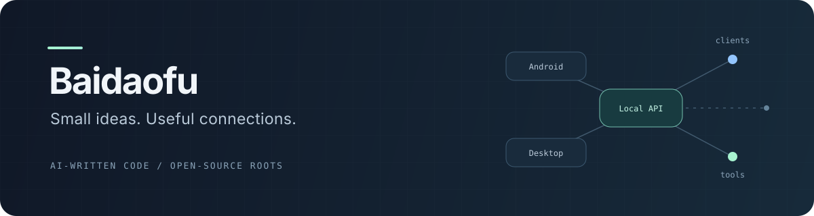

  

  <b>把「要是能这样就好了」，变成一个可以试试的小工具。</b>

  手机里的服务，电脑上的客户端，中间缺的那一小段连接。 
  这里放着一些围绕日常使用需求展开的尝试，也留着折腾过的痕迹。

  <a href="#一些小工具">一些小工具</a> &nbsp; / &nbsp;
  <a href="#关于这些仓库">关于这些仓库</a> &nbsp; / &nbsp;
  <a href="https://github.com/Baidaofu?tab=repositories">全部仓库 ↗</a>

---

## 一些小工具

不是技术栈清单，只是几件想让它更顺手的事。

<table>
  <tr>
    <td width="50%" valign="top">
      <h3><a href="https://github.com/Baidaofu/MiniTavernBridge">MiniTavernBridge ↗</a></h3>
      
在 MiniTavern 和通用 AI 客户端之间，补上一座小桥。

      
把后端包装成本地 OpenAI 兼容接口，提供 Android 应用和 Windows 终端两种入口。

      
Android / Windows · 本地代理 · 流式对话

    </td>
    <td width="50%" valign="top">
      <h3><a href="https://github.com/Baidaofu/niji-local">niji-local ↗</a></h3>
      
让手机里的图像生成，也能接进熟悉的工作流。

      
为 niji・journey 提供本地接口，连接 OpenAI、NovelAI 和 A1111 兼容客户端。

      
Android · LSPosed · 图像生成

    </td>
  </tr>
  <tr>
    <td width="50%" valign="top">
      <h3><a href="https://github.com/Baidaofu/GLM-Free-APK">GLM-Free-APK ↗</a></h3>
      
把原本跑在服务端的工具，装进口袋。

      
基于上游 GLM-Free-API 的 Android 封装，在手机上启动服务、调整设置和查看日志。

      
Android · 上游移植 · 本地服务

    </td>
    <td width="50%" valign="top">
      <h3><a href="https://github.com/Baidaofu/deepseek-api">deepseek-api ↗</a></h3>
      
给 DeepSeek Android 补上连接外部客户端的入口。

      
基于上游 Deekseep 的调整版本，恢复 Local API，提供 OpenAI / Anthropic 兼容网关。

      
Android · 上游改版 · API 兼容

    </td>
  </tr>
</table>

另外两件小东西：

- [**deekseep-onlyapi**](https://github.com/Baidaofu/deekseep-onlyapi) — 将 Local API 独立重实现为轻量模块，少一点界面，多一点连接。
- [**WarpLovesanyone**](https://github.com/Baidaofu/WarpLovesanyone) — 基于 WarpLovesPlayStore 的改版，让选定应用走 WARP，顺便让深色模式跟随系统。

## 关于这些仓库

**这里的项目代码全部由 AI 完成。** 不把它们当作个人技术能力的证明；比起一份作品履历，这里更像一张由实际需求、AI 和开源项目共同拼起来的工具桌。

移植、改版和 fork 都有各自的来处。已有的开源成果是这些尝试的起点，原作者的工作与贡献不应被 AI 生成的改动盖过去。

  
开源来处与使用说明

- **GLM-Free-APK**：服务端来自 [GLM-Free-API](https://github.com/izaart95-jpg/GLM-Free-API)，Android 工程结构参考 [ds2api-android](https://github.com/SUN-0v/ds2api-android)。
- **deepseek-api / deekseep-onlyapi**：基于 [Deekseep](https://github.com/lllucccian/Deekseep) 的相关工作。
- **WarpLovesanyone**：来自 [WarpLovesPlayStore](https://github.com/BruceZhang1993/WarpLovesPlayStore)。
- 其他 fork 的来源可在对应仓库查看；具体许可、依赖、设备要求与已知限制，以各项目 README 为准。
- 这些工具有各自的使用条件，也可能随上游变化而失效。遇到问题，可以在对应仓库留下复现信息。

---

  想法可以很小，能让日常顺手一点就好。

